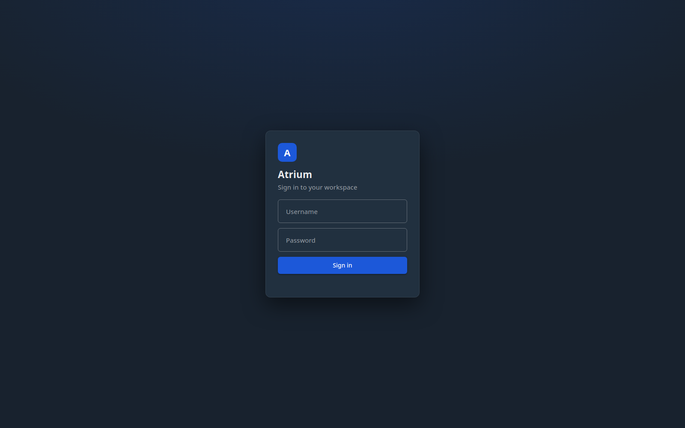
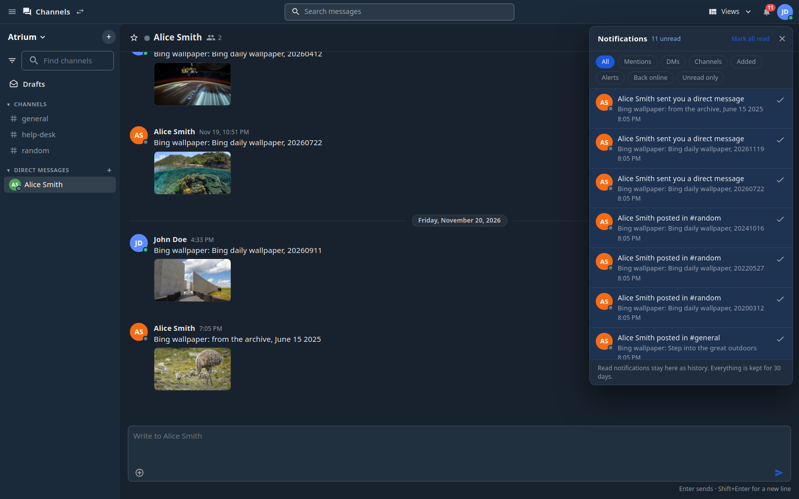
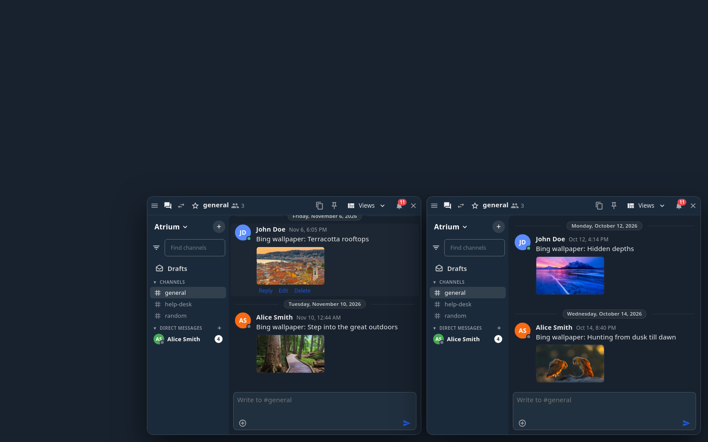
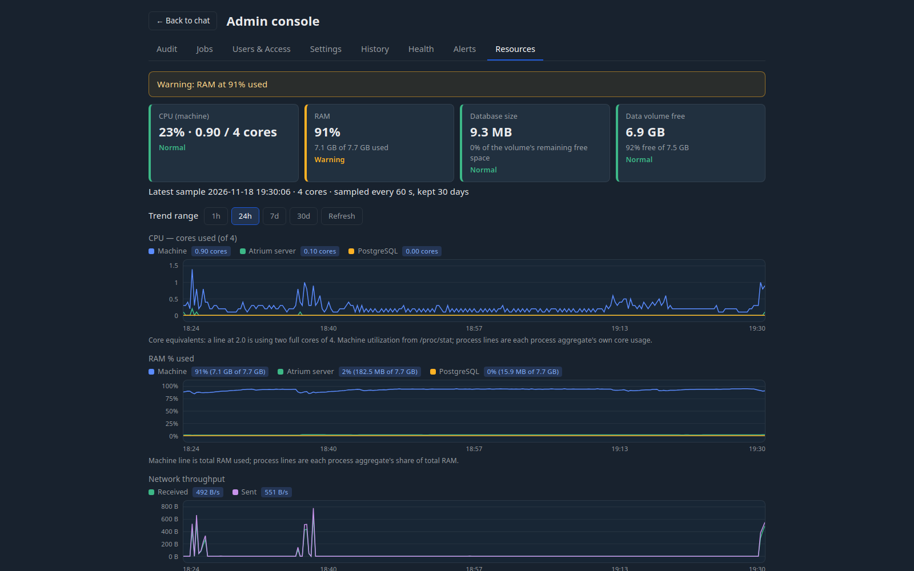

# Screenshot gallery

Atrium — every screen at a glance. The threads view is at build 261118_2133; the other screens are at build 261118_1820, unchanged in those areas. Click any thumbnail for the full-size image. [Back to the README](../README.md)

## Client

<table>
  <tr>
    <td align="center"> <b>Sign-in</b> Local accounts; AD/Kerberos when enabled</td>
    <td align="center"> <b>Chat</b> Channels, DMs, read-time presence</td>
    <td align="center"> <b>Search</b> Full-text, membership-scoped</td>
  </tr>
  <tr>
    <td align="center"> <b>Action center</b> Persisted notifications, kind filters</td>
    <td align="center"> <b>Profile card</b> Click-to-copy details, back-online alerts</td>
    <td align="center"> <b>Picture viewer</b> Gallery rail, continuous zoom</td>
  </tr>
  <tr>
    <td align="center"> <b>Pop-out instances</b> Identical small views, no cap</td>
    <td align="center"> <b>Threads</b> One-level replies, follow state, read positions</td>
    <td></td>
  </tr>
</table>

## Admin console

<table>
  <tr>
    <td align="center"> <b>Message policy</b> Global, per-channel, per-user rules</td>
    <td align="center"> <b>Settings</b> Grouped save, one snapshot per save</td>
    <td align="center"> <b>Resources</b> Monitoring in core equivalents</td>
  </tr>
  <tr>
    <td align="center"> <b>Health</b> Six checks, measured values, diagnostics zip</td>
    <td></td>
    <td></td>
  </tr>
</table>
